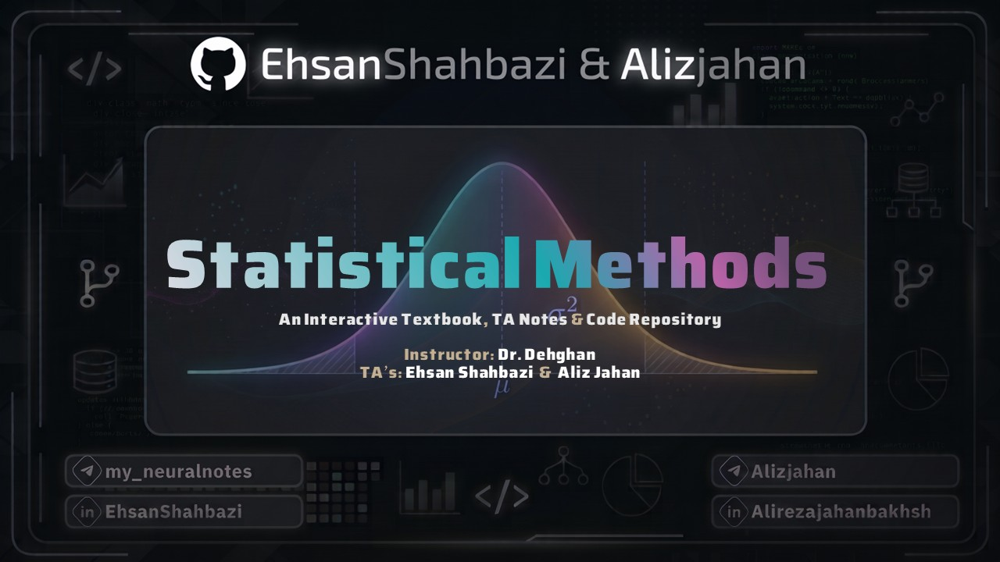

<div align="center">



# روش‌های آماری | Statistical Methods

**از فرمول به شهود؛ آمار را بخوانید، ببینید و تجربه کنید.**

A Persian interactive statistics textbook, with visual experiments and downloadable LaTeX notes.


[📖 منبع جزوه](dist/assets/lecture.tex) · [📥 PDF کامل](dist/assets/lecture.pdf)

</div>

<div dir="rtl">

## یک جزوه، چند راه برای فهمیدن

این پروژه، جزوهٔ درس **روش‌های آماری دکتر سکینه دهقان** را به یک کتاب تعاملی فارسی تبدیل می‌کند: متن و فرمول‌ها را بخوانید، پارامترهای آزمایش‌ها را تغییر دهید، رفتار نمودارها را ببینید و نسخهٔ PDF یا لاتک هر فصل را همراه خود داشته باشید.

گردآورندگان جزوه: **[علیرضا جهانبخش](https://github.com/Alizjahan) و [احسان شهبازی](https://github.com/EhsanShahbazii)**.

توسعهٔ وبسایت: **[احسان شهبازی](https://github.com/EhsanShahbazii) و [علیرضا جهانبخش](https://github.com/Alizjahan)**.

## چه چیزی اینجا پیدا می‌کنید؟

| 📚 مطالعه | 🧪 تجربه | 📥 همراه داشتن |
|:---|:---|:---|
| کتابخوان فارسی و راست‌به‌چپ | ۹ آزمایشگاه تعاملی | PDF کامل جزوه |
| جست‌وجو در محتوای کتاب | تغییر پارامترها با اسلایدر | PDF مستقل هر فصل |
| نشان‌گذاری و حفظ پیشرفت مطالعه | نمودارهای SVG با گذار نرم | منبع LaTeX کامل و فصل‌ها |
| تنظیم اندازهٔ متن و پوسته | ۵ شکل اصلی بازطراحی‌شده | PDFخوان داخل مرورگر |

فرمول‌ها با **KaTeX** و متن با **Vazirmatn** نمایش داده می‌شوند. فونت‌ها، موتور نمایش PDF و کتابخانه‌های مورد نیاز سایت به‌صورت محلی در پروژه قرار دارند؛ رابط برای اندازه‌های مختلف صفحه طراحی شده و ترجیح کاهش حرکتِ دستگاه را رعایت می‌کند.

## آمار را با تغییر دادن یاد بگیرید

| آزمایشگاه | با چه چیزی کار می‌کنید؟ | چه چیزی روشن‌تر می‌شود؟ |
|:---|:---|:---|
| 🎲 احتمال دوجمله‌ای | تعداد تکرارها و احتمال موفقیت | شکل توزیع و احتمال رخدادها |
| 🔔 توزیع نرمال | میانگین و انحراف معیار | جابه‌جایی مرکز و تغییر پراکندگی |
| 🎯 اریبی و MSE | رفتار برآوردگر | ارتباط اریبی، واریانس و خطای برآورد |
| 📊 قضیهٔ حد مرکزی | توزیع جامعه و حجم نمونه | شکل توزیع میانگین‌های نمونه‌ای |
| 📏 پوشش فاصلهٔ اطمینان | نمونه‌گیری و سطح اطمینان | معنای تکرارپذیرِ پوشش پارامتر |
| 📐 استنباط واریانس | پارامترهای نمونه و توزیع کای‌دو | ساخت فاصلهٔ اطمینان برای واریانس |
| 🔗 داده‌های زوجی | همبستگی بین اندازه‌گیری‌ها | اثر زوج‌سازی بر خطای استاندارد |
| 🔍 آزمون فرض | آماره، نوع آزمون و دُم‌ها | مقدار p و ناحیهٔ رد |
| ⚡ توان آزمون | سطح خطا، حجم نمونه و اندازهٔ اثر | موازنهٔ خطاهای نوع اول و دوم و توان |

آزمایش‌ها در کنار بخش مرتبط کتاب هم در دسترس‌اند. نمونه‌گیری‌ها با بذر قابل تکرار انجام می‌شوند و فرض‌های مدل در رابط توضیح داده شده‌اند.

## کتابخانهٔ دانلود

برای مطالعه به ترتیب فصل یا چاپ یک بخش مشخص:

| بخش | PDF | LaTeX |
|:---|:---:|:---:|
| راهنمای استفاده | [دانلود](dist/assets/chapters/chapter-0.pdf) | [منبع](dist/assets/chapters/chapter-0.tex) |
| فصل اول · احتمال و توزیع‌ها | [دانلود](dist/assets/chapters/chapter-1.pdf) | [منبع](dist/assets/chapters/chapter-1.tex) |
| فصل دوم · برآورد نقطه‌ای | [دانلود](dist/assets/chapters/chapter-2.pdf) | [منبع](dist/assets/chapters/chapter-2.tex) |
| فصل سوم · فاصله‌های اطمینان | [دانلود](dist/assets/chapters/chapter-3.pdf) | [منبع](dist/assets/chapters/chapter-3.tex) |
| فصل چهارم · آزمون فرض | [دانلود](dist/assets/chapters/chapter-4.pdf) | [منبع](dist/assets/chapters/chapter-4.tex) |
| پیوست | [دانلود](dist/assets/chapters/chapter-5.pdf) | [منبع](dist/assets/chapters/chapter-5.tex) |
| **جزوهٔ کامل کتاب** | **[دانلود PDF](dist/assets/lecture.pdf)** | **[منبع کامل](dist/assets/lecture.tex)** |

### کلاس‌های حل تمرین (TA Sessions)

| جلسه | عنوان و سرفصل‌ها | دریافت جزوه |
|:---|:---|:---:|
| **جلسه اول** | برآورد نقطه‌ای، نااریبی، کارایی، سازگاری و ۶ تمرین حل‌شده | **[دانلود PDF (۳۲ صفحه)](dist/assets/ta/session-1.pdf)** |
| جلسه دوم | موضوعات و تمرین‌های جلسه دوم | به‌زودی |
| جلسه سوم | موضوعات و تمرین‌های جلسه سوم | به‌زودی |
| جلسه چهارم | موضوعات و تمرین‌های جلسه چهارم | به‌زودی |

فایل‌های لاتک فصل‌ها مستقل‌اند و تعریف‌ها و شکل‌های لازم را همراه دارند؛ برای کامپایل آن‌ها از **XeLaTeX** استفاده کنید.

## اجرا در کمتر از یک دقیقه

برای دیدن نسخهٔ آماده، در پوشهٔ پروژه اجرا کنید:

</div>

```sh
python3 -m http.server 4173 --directory dist
```

<div dir="rtl">

سپس [localhost:4173](http://localhost:4173) را باز کنید. نسخهٔ آماده به نصب وابستگی‌های Node.js یا ابزارهای لاتک نیاز ندارد.

### بررسی کد و محتوا

</div>

```sh
npm ci
npm run check
npm test
```

<div dir="rtl">

بررسی‌های خودکار، رندر **۶۲۳ عبارت ریاضی**، مقادیر مرجع توزیع‌های نرمال، کای‌دو، استیودنت و دوجمله‌ای، اتصال **۳۹ بخش، ۵ شکل و ۹ آزمایشگاه**، هماهنگی فایل‌های دانلود با منبع جزوه و درون‌یابی نمودارها را کنترل می‌کنند.

</div>

<details>
<summary><strong>🛠 بازسازی نسخهٔ وب و خروجی فصل‌ها از منبع لاتک</strong></summary>

<div dir="rtl">

به Python، Node.js، XeLaTeX و فونت‌های **Amiri** و **TeX Gyre Termes** نیاز دارید. وابستگی‌های پایتون در `requirements-build.txt` ثبت شده‌اند؛ Pandoc از بستهٔ `pypandoc_binary` تأمین می‌شود.

</div>

```sh
npm ci
python3 -m venv .venv
source .venv/bin/activate
python -m pip install -r requirements-build.txt
npm run build
npm run check
npm test
```

<div dir="rtl">

ابزار ساخت ابتدا فایل اصلی `main.tex` را در پوشهٔ همسایهٔ `Statistical Methods/جزوه استاد/` می‌خواند؛ اگر آن فایل در دسترس نباشد، از `dist/assets/lecture.tex` استفاده می‌کند. پس از تغییر منبعِ داخل ریپو، PDF کامل را نیز با XeLaTeX بازتولید و در `dist/assets/lecture.pdf` جایگزین کنید. خروجی‌های مستقل فصل‌ها هنگام اجرای ساخت بازتولید می‌شوند.

برای بازسازی فقط فصل‌ها:

</div>

```sh
python tools/build_chapter_exports.py
```

</details>

<div dir="rtl">

## انتشار روی GitHub Pages

پوشهٔ `dist/` یک سایت استاتیک مستقل است. گردش‌کار [GitHub Pages](.github/workflows/pages.yml) وابستگی‌ها را نصب می‌کند، بررسی‌ها را اجرا می‌کند و همین پوشه را منتشر می‌کند. مسیرهای نسبی و مسیریابی مبتنی بر hash برای آدرس پروژه در GitHub Pages آماده‌اند.

در تنظیمات ریپوی GitHub، در **Settings → Pages → Source** گزینهٔ **GitHub Actions** را انتخاب کنید و گردش‌کار را اجرا کنید.

## پشت صحنه

| بخش | ابزار |
|:---|:---|
| رابط و تعامل | JavaScript Modules · HTML · CSS |
| فرمول‌ها | KaTeX |
| PDFخوان | PDF.js |
| تایپوگرافی فارسی | Vazirmatn |
| نمودار و حرکت | SVG · Web Animations API |
| آماده‌سازی محتوا | Python · Pandoc |
| حروف‌چینی جزوه | LaTeX · XeLaTeX · TikZ |

</div>

```text
.
├── dist/                  # سایت آمادهٔ انتشار
│   ├── index.html         # پوستهٔ کتابخوان
│   ├── app.js             # مطالعه، جست‌وجو و PDFخوان
│   ├── labs.js            # محاسبات و آزمایشگاه‌ها
│   ├── motion.js          # حرکت رابط و نمودارها
│   ├── book.json          # محتوای ساختاریافتهٔ کتاب
│   ├── assets/            # PDF و LaTeX کامل و فصل‌ها
│   ├── fonts/             # فونت‌های فارسی
│   └── vendor/            # وابستگی‌های محلی و مجوزهای آن‌ها
├── tools/                 # تبدیل محتوا، تولید فصل‌ها و بررسی صحت
├── docs/assets/           # بنر معرفی پروژه
└── .github/workflows/     # انتشار GitHub Pages
```

<div dir="rtl">

## حریم خصوصی و شفافیت

سایت، دادهٔ دانشجو را به سرور ارسال نمی‌کند؛ وضعیت مطالعه و تنظیمات در `localStorage` همان مرورگر ذخیره می‌شود. آزمایشگاه‌ها ابزار آموزشی‌اند و از محاسبات عددی و شبیه‌سازی استفاده می‌کنند.

مجوز وابستگی‌های همراه در [پوشهٔ مجوزها](dist/vendor/licenses) قرار دارد.

## همراهی با پروژه

اگر فرمول، توضیح یا رفتاری نیاز به اصلاح دارد، یک Issue همراه با **نام فصل، عنوان بخش، نتیجهٔ فعلی و نتیجهٔ مورد انتظار** ثبت کنید. برای پیشنهاد آزمایشگاه جدید، مفهوم آموزشی و تغییری که دانشجو باید بتواند در آن مشاهده کند را توضیح دهید.

</div>

---

<div align="center">

**توسعه داده شده با ❤️ برای آماردان‌های آینده توسط [احسان شهبازی](https://github.com/EhsanShahbazii) و [علیرضا جهانبخش](https://github.com/Alizjahan)**

با سپاس از **دکتر سکینه دهقان**، استاد درس روش‌های آماری.

</div>
